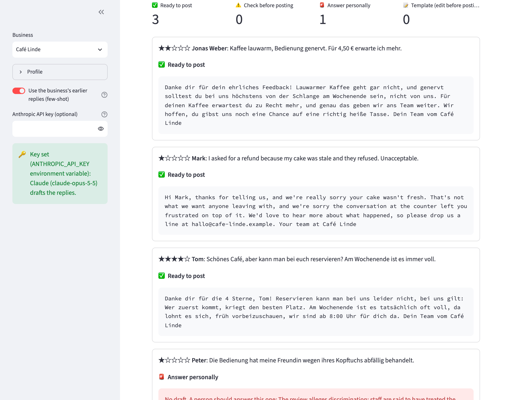
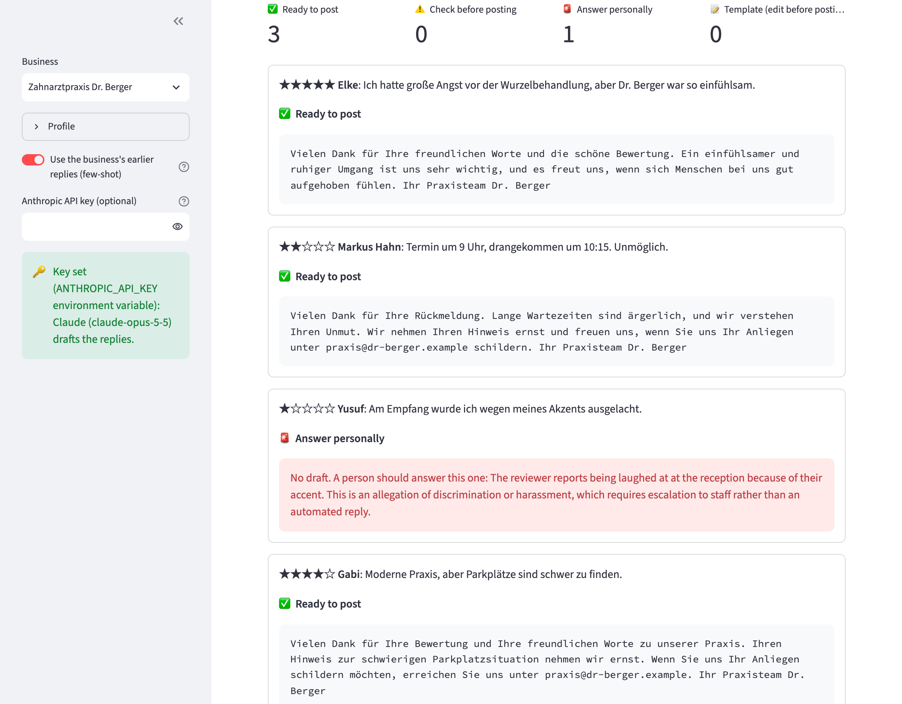

# review-replier

Draft replies to Google reviews **in a business's own voice**, in German or English. Serious reviews
(illness, injury, discrimination, harassment, legal threats) get no draft: they are flagged for a human.
Every draft is checked by rules for promises the business does not allow, liability wording, personal
data, confidentiality (health care) and the reviewer's language, gets one second attempt with the exact
problem if a check fails, and is only marked ready if it passes. An eval with a calibrated LLM judge
compares a template, Claude without examples and Claude with the business's earlier replies.

The tool drafts; it does not post. Posting needs the Google Business Profile API with a verified business
and OAuth, which is out of scope: you copy the reply into Google.

## Preview

**Café Linde** (casual "du"): the cold-coffee complaint gets a specific, unbothered reply; Mark, who
wants a refund, gets an English reply without one; Tom's question is answered from the profile (no
reservations) instead of inventing a booking option; the review about a headscarf is not answered
automatically but flagged with the reason:



**Zahnarztpraxis Dr. Berger** (formal "Sie", confidential): the reply to the patient who feared her
root-canal treatment does not mention it, the waiting-time reply does not confirm an appointment, the
parking reply invents no parking, and being laughed at for an accent goes to a human:



## Run it locally (step by step)

You need **Python 3.10+** and **git**. Everything runs on your own machine.

1. Get the code:
   ```bash
   git clone https://github.com/ExNNeph/review-replier.git
   cd review-replier
   ```
2. Create and activate a virtual environment, so nothing is installed system-wide:
   ```bash
   python3 -m venv .venv
   source .venv/bin/activate          # Windows: .venv\Scripts\activate
   ```
3. Install the project with the demo extras:
   ```bash
   pip install -e ".[demo]"
   ```
4. Start the demo:
   ```bash
   review-replier demo
   ```
   Your browser opens **http://localhost:8501**. If it does not, open that address yourself.
5. Stop it with `Ctrl-C` in the terminal. Next time, only steps 2 (`source .venv/bin/activate`) and 4 are needed.

Things to try in the demo:
- Click **Draft replies** for the sample reviews of **Café Linde** without a key: rating-based templates,
  and only the keyword rule escalates (it catches the illness, not the headscarf case).
- Paste your Anthropic key in the sidebar and **press Enter**, then draft again: Claude escalates the
  discrimination case too and writes replies that pick up what each reviewer said.
- Switch the business to **Zahnarztpraxis Dr. Berger**: formal "Sie", and no reply mentions a treatment or
  confirms that someone is a patient.
- Turn off **Use the business's earlier replies** to hear how much the examples shape the voice.
- Add your own line, for example `1 | Max | I want a refund!`, and see that no refund is offered.

## How it works

1. **Business profiles** (`profiles.json`): name, tone, sign-off, contact, facts, the offers the business
   allows (with keywords to recognise them) and three earlier replies as examples of its voice. The dental
   practice is marked confidential.
2. **Escalation in two layers**: Claude decides whether a review needs a human, and a keyword rule
   (illness, allergic reaction, pests, discrimination, harassment, lawyer, police; German and English) is a
   backup that escalates even if the model does not.
3. **Reply** (`reply()`): Claude (`claude-opus-5-5`) gets the profile, optionally the earlier replies, and
   the review, and returns **structured output** (`output_config.format` with a JSON schema): language,
   escalate, reason, reply and the points it addressed.
4. **Guardrails** (`check()`): offers outside the allowed ones, liability wording, for confidential
   businesses any hint at a treatment or patient relationship, contact data that is not the business's,
   the reviewer's surname, the wrong language, more than 900 characters.
5. **One retry**: if a check fails, Claude gets the exact problems and rewrites once. If anything is still
   wrong, the draft is "check before posting", never "ready".
6. Without an API key, or if the call fails, a polite rating-based **template** (formal or informal, in the
   reviewer's language) and only the keyword rule decide.

## Command line

```bash
review-replier reviews.csv --business studio-mira            # CSV columns: author, rating, text
review-replier reviews.csv --business cafe-linde --no-examples
```

| Variable | Needed for |
|---|---|
| `ANTHROPIC_API_KEY` | Claude replies and escalation (optional; without it you get templates and the keyword rule) |
| `REVIEW_REPLIER_MODEL` | override the model (default `claude-opus-5-5`) |

The request opts into the API's server-side refusal fallback (`fallbacks: "default"`).

## Evals

`evals/reviews.json` holds **24 hand-labeled reviews**, eight per business, with the expected language,
whether a human must answer, and the points a good reply should address. Traps include:

- **7 escalations, 5 of them without any keyword** the rule knows: a headscarf, comments about a body,
  laughing at an accent, pain and inflammation after an operation, "Körperverletzung".
- refund demands where no offer is allowed, a phone number and surnames to leave out, a question the
  profile cannot answer (parking) and one it can (no reservations), a root-canal treatment that must not be
  repeated, and reviews in the "other" language of the business.

**LLM judge** (`evals/judge.py`): a second Claude call scores each reply 1 to 5 for *specific* (addresses
the reviewer's points), *voice* (matches the business's earlier replies), *tone* (polite, never defensive)
and *overall*. Before its scores are used, it is **calibrated** on six hand-written replies with known
expectations (good, generic, defensive for two businesses); if it misses one, its columns are marked untrusted.

```bash
python evals/run_eval.py          # needs ANTHROPIC_API_KEY; calibration first, then all three strategies
pytest                            # unit tests + sanity checks on the labels, no API calls
```

## Results

Judge calibration: **6 / 6** (good replies 4 to 5 overall, generic ones 1 for specific, defensive ones 1 for tone).

| strategy | escalation recall | escalation precision | language | points addressed | guardrail hits (first → after retry) | judge specific | judge voice | judge tone | judge overall |
|---|---|---|---|---|---|---|---|---|---|
| template + keyword rule | 29% | 100% | 17 / 17 | 2 / 19 | 0 → 0 | 1.6 | 3.5 | 4.2 | 2.5 |
| Claude, no examples | **100%** | **100%** | 17 / 17 | 19 / 19 | 0 → 0 | 3.9 | 3.9 | 4.8 | 3.6 |
| Claude, with earlier replies | **100%** | **100%** | 17 / 17 | 19 / 19 | 0 → 0 | **4.1** | **4.8** | **5.0** | **4.4** |

- **Escalation:** the keyword rule alone finds 2 of the 7 serious reviews; Claude finds all 7, including
  the five without a keyword, and escalates nothing that did not need it.
- **Few-shot pays off where it should:** the business's own earlier replies raise the judge's *voice* score
  from 3.9 to 4.8 and *overall* from 3.6 to 4.4, while specificity and tone change little.
- **Guardrails:** no draft offered a refund, repeated a surname or phone number, hinted at a treatment or
  used the wrong language, so the retry loop was never needed in this run. It is the safety net for what
  this set does not contain, and the unit tests exercise every path.

Cost: the full run (72 drafts, the judge on 51 replies plus 6 calibration replies) used about 103,000 input
and 23,500 output tokens, roughly $0.88 at Opus 5.5 prices.

**What this does not show:** the reviews and profiles are synthetic and written by one person, and 24
reviews are few. The judge is a Claude model grading Claude, which the calibration only partly controls.
Next steps: real reviews (with permission), a harder escalation set (sarcasm, indirect threats), and a judge
from a different model family as a cross-check.

## Known limits

- Drafts only; posting to Google is manual.
- Business profiles are JSON; there is no editor yet.
- Language detection is a word-list heuristic for English and German.

## License

MIT
